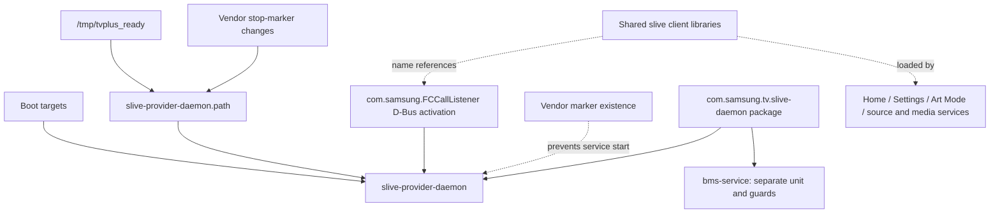

# Samsung Frame privacy and background-service catalogue

Reviewed 2026-10-24 on QN65LS03BAFXZA, Tizen 6.5,
T-PTMAKUC-1720.7. This is an investigation record, not a cleanup script.
Companion: [control and rollback runbook](samsung-tv-developer-control.md).

The owner wants to minimize viewing analysis, advertising and unused voice
services while preserving streaming apps, Art Mode, HDMI/audio, SmartThings,
Google Home device control and OpenClaw control. The initial read-only review
was followed by owner-authorized cleanup, AOV/far-field guards and a full
restart. Historical findings below are labelled by phase.

## Current status and remaining checks

**Verified after the full restart:** all 24 targeted app-disable records and six
stop markers persisted; targeted voice/advertising/TV Plus processes were absent
in initial and delayed checks; shared audio services started normally. The owner
confirmed the usual HDMI cable-disconnected screen. The extra four runtime masks
were restored after observing startup; they still expire at the next full boot.

**Resource baseline:** idle HDMI at about 4½ minutes after boot measured 28.2%
CPU busy, 598 MiB available RAM, 656 MiB occupied logical swap, and load 11.45.
The preceding Netflix workload differed, so this is not a controlled performance
improvement result. See [full restart verification](#full-restart-verification-2026-10-24-later-that-evening).
The exact reboot command and gated dispatch procedure are in the
[control runbook](samsung-tv-developer-control.md#full-remote-restart-maintainer-operation).

Remaining checks, rather than another generic reboot task:

- A separate standby/wake cycle, with guard/process checks afterward.
- Post-restart audible playback and SmartThings/Google Home controls; the owner
  confirmed those before the reboot. Art Mode switching, HDMI/source changes,
  Spotify Connect and a repeated navigation-responsiveness comparison also remain.
- Post-restart UI consent state and the TV Plus autorun preference were not
  separately rechecked. Voice recognition and assistant prelaunch still read false.
- Physical microphone-switch state, alternate AOV modes and remote-microphone
  behavior remain unverified. Soundbar recording support exists in the installed
  code; arbitrary network-microphone activation or transmission was not established.

Recovery: the original four-group cleanup uses `*-restore-v3.sh`; AOV/far-field
uses `restore-v2.sh` with its matching SQL and `RECOVERY_CURRENT`. See their
[recovery records](#recovery-records) and [AOV guard records](#authorized-aov-and-far-field-guards).
Retain both sets; restoring one group does not undo all maintenance.

## Findings that change the cleanup plan

**Follow-up maintenance status:** the owner subsequently authorized all four
cleanup groups in one pass. The batch and its resolved respawn investigation
are recorded in [the maintenance section](#authorized-maintenance-batch).
The observations in the table below describe the earlier read-only review.

| Component | Evidence on this TV | Implication |
| --- | --- | --- |
| PISA main service / content-analysis daemon | Both remain inactive with MainPID 0 and failed start conditions from our existing markers. | Earlier stops still hold in this boot. Full-restart persistence remains untested. |
| PISA ad agent | Running independently; binary contains `rtb-config.samsungads.com` and its canary counterpart. Uses the same PISA stop marker. | Advertising connection is supported by static endpoint evidence, but no upload was established. Stopping PISA did not stop this sibling. |
| Ad-agent local client | A live loopback TCP connection links `HomeMedia.dll` to the ad agent on port 19201. | A stop trial must include Home Media responsiveness and retry behavior. Do not kill Home Media as a shortcut. |
| Targeted-ad service | Manifest explicitly identifies advertising; on-boot and auto-restart are enabled, with an allowed-app reference to `org.tizen.hbbtv`. Running. | Separate lifecycle and HbbTV integration; not covered by the PISA marker. A process kill alone is unlikely to be durable. |
| Alexa client | Running; one established public-address TCP/443 socket and four CLOSE_WAIT sockets in the sample. Manifest declares microphone/recorder capabilities. | Prioritize lifecycle investigation for this unused client. Capabilities and connections do not prove recording or audio transmission. |
| Bixby capsule viewer | Resident; observed TCP endpoints were loopback. | Candidate for closing unused voice UI. No observed public connection is not proof of no indirect or intermittent traffic. |
| ACR app | Installed, manifest identifies ACR, internet privilege and auto-restart. Not observed as a process in the scoped samples. | Consent opt-out is important; installed/preload flags do not establish that ACR is currently collecting. |
| Samsung Analytics | Installed; manifest identifies Samsung Analytics, with internet capability. Binary contains `dc.di.atlas.samsung.com`. Not observed as a process in the scoped samples. | Catalogue separately from ACR; static hostname is not evidence of a connection or its payload. |
| Contents-recognition / screen-analysis services | Both running; contents-recognition has Restart=always and three recorded restarts. No verified stop-marker condition in either unit. | Their exact role and consent gating remain unresolved. Restart count alone does not establish a current crash loop. |
| Context-aware service | Running; explicitly Requires `data-service.service`. Context agent also running. | Do not apply upstream's blanket data-service mask. Shared framework dependencies need more evidence. |

No packet contents, viewing-history database records, account identifiers,
credentials or microphone recordings were collected. This review does not prove
that the TV currently sends viewing history after opt-out, nor establish zero
collection.

## TV Plus dependency map

The installed `com.samsung.tv.slive-daemon` manifest describes a TV Plus and
channel-metadata package. It contains both `slive-provider-daemon` and
`org.tizen.bms-service`, plus media libraries. Both services were running.

Observed activation and dependency details:

- `slive-provider-daemon.service` uses Restart=always and a negated
  `/opt/usr/share/systemd/system/slive-provider-daemon` condition. Its boot
  consumers include starter, TIMER-starter and PNP-after targets.
- Its path unit watches `/tmp/tvplus_ready` and changes to that marker. Its
  D-Bus activation unit owns `com.samsung.FCCallListener` and names the provider.
- RequiredBy, BindsTo and PartOf were empty. This excludes listed hard unit
  dependencies, not D-Bus callers, application expectations or indirect users.
- `bms.service` has separate `bms_block`, `bms` and boot-mode conditions, a path
  activator and its own boot targets. Its precise functional scope is unresolved;
  it must not be swept into a provider-only stop trial.
- 45 processes mapped at least one selected slive client/framework
  library. They included Home Media, Home sidebar, Settings, Art Mode, volume,
  source service, HDMI-CEC, TV viewer, Spotify and HbbTV. A mapped library may be
  inherited or unused; this does **not** demonstrate an active call or prove that
  all those features need the provider running.
- No directly owned TCP/UDP socket appeared for the provider or BMS in their
  respective samples. Local IPC, delegated networking and activity between
  samples remain possible.

Conclusion: retain the package and shared libraries. A future provider-only
trial is plausible using its vendor condition, but must verify Home, Settings,
Art Mode, source switching, audio, streaming and remote control. Do not describe
it as dependency-free or claim it is an isolated TV Plus app.

## Network evidence and limits

Socket ownership was matched from selected process file descriptors to the
kernel TCP/TCP6/UDP/UDP6 tables. Alexa, the ad agent and the inspected host process
shared the same network namespace. The supplemental sample included BMS and
contents-recognition, whose truncated process name was missed by the first
name-based selector.

The only public-address sockets attributed to the selected processes in the
first sample belonged to Alexa: one ESTABLISHED and four CLOSE_WAIT, all remote
port 443. CLOSE_WAIT is not an actively established session. The review did not
verify TLS, destination ownership, payloads or bytes transferred. Bixby's TCP
connections were loopback, the ad agent had a loopback listener/client pair, and
voice-client had a UDP socket bound to a multicast address. These observations
do not cover every process, short-lived connections, shared web/network helpers,
all network namespaces or a complete viewing session.

Static hostname extraction read only selected installed binaries and retained
URL scheme/host strings, without paths or query parameters. Important leads:

| Binary | Static hostnames worth investigating | Limit |
| --- | --- | --- |
| adagent-service | `rtb-config.samsungads.com`, `rtb-config-canary.samsungads.com` | Configuration endpoints; no connection observed to them. |
| samsung-analytics | `dc.di.atlas.samsung.com` | Compiled-in destination, not an observed upload. |
| acr | `acr-us-stg.internetat.tv` | Staging hostname; not established as the production endpoint. |
| slive-provider-daemon | `time.samsungcloudsolution.com`, `tvpnlogoseu.samsungcloud.tv` | Time/logo-looking names; purpose and actual use not verified. |

This list is **not** a DNS blocklist. It is incomplete, may include unused/test
strings, and blocking shared Samsung hosts could impair the features the owner
uses. No hostname was contacted just because it appeared in a binary.

## Privacy controls and policy context

The owner already opted out of Viewing Information Services and Interest-Based
Advertisements in the native UI; both were verified unchecked after saving and
reopening. TV Plus autorun, voice recognition and assistant prelaunch preferences
were also set false. None of those observations proves that every process exits.

Samsung describes ACR as generating signatures to identify viewing activity,
with viewing information and identifiers governed by the Viewing Information
Services choice. See [Samsung's ACR explanation](https://www.samsung.com/us/support/answer/ANS10010616/).
Its [Ads privacy notice](https://policy.samsungrs.com/) separately describes
device/app usage, identifiers and advertising interactions, with viewing-history
use tied to the relevant consents. Its opt-out language concerns customized
advertising, not elimination of every Samsung service or advertisement.

[TV Plus's US notice](https://terms-us.samsungtvpm.com/US/TV_Plus_US_pn_202406_English_US.html)
describes viewing and usage information for operating and improving that service,
separately from optional personalized advertising. Those policy descriptions
explain why the categories matter; they do not establish what this TV transmitted.
Streaming providers also have their own data practices beyond this Samsung audit.
Samsung account Customization Service and deletion of previously collected data
were not inspected or changed in this phase.

## Plan before application

1. Prepare an ad-agent-only stop trial with fresh before-state, Home Media checks
   and an explicit inverse. The existing PISA marker is shared; simply removing
   it to restore the ad agent could also permit the main PISA service to start.
2. Resolve Alexa/Bixby app-manager launch and preload behavior, including the
   multi-assistant coordinator. Alexa's manifest also lists Spotify as an allowed
   caller; that is an integration clue, not proof Spotify requires Alexa. Check
   Spotify Connect after any voice-client trial. Preserve Google/SmartThings
   cloud control rather than assuming it uses these native voice clients.
3. Investigate targeted-ad/HbbTV separately. Verify the supported setting or
   exact lifecycle control before changing registry fields or repeatedly killing
   a service declared on-boot/auto-restart.
4. Trial the TV Plus provider independently of BMS and shared libraries, with the
   feature checks above. Defer shared context/data-service and screen-analysis
   changes until their consumers and reversible controls are understood.
5. Measure selected process/destination metadata over a longer normal-use period,
   then compare after each trial. A future network policy should use verified
   destinations and explicit regression checks, not this static string list.
6. At this planning stage the reboot was deferred. The later full restart
   verified targeted app flags, markers and process state; remaining control
   checks are listed in the current-status section above.

## Evidence and provenance

Private evidence is on the Mini under
`~/.local/share/samsung-tv-tools/changes/20261024-privacy-catalogue/`:
`dependencies`, `sockets`, `package-details`, `clients`, and `recognition` each
have a reviewed shell probe and captured result. Decoded socket addresses stay
private in `sockets-decoded.json`; only summarized findings are recorded here.
`baseline-lifecycle.json` records selected app metadata from the immutable
`20261024T223648Z-expanded-baseline`, not a fresh live registry snapshot.

The temporary root runner verified UID/EUID, removal of its staging, unchanged
protected system files, and cleanup of its owned host SDB listener for all five
probes. This is operational verification, not a functional regression test after
cleanup: no cleanup was applied. Original baseline and rollback archives remain
unchanged. Quiet Tizen was read as a reference only; its installers and cleanup
generators were not executed.

## App lifecycle inventory

The following 35 entries combine installed reference candidates with this TV's
own TV Plus IDs. Flags come from the expanded baseline. `P/B/R` means preload,
on-boot and auto-restart. All listed rows reported `app_disable=false` and
`app_support_disable=false`. These flags do not prove a component is running or
authorize forcing an unsupported disable operation. “Seen” means its executable
was observed in this review's process or library-mapping samples; “not seen” is
not proof that it never runs. Generic web processes are not assigned an app ID
solely from their truncated names.

| Group | App ID | P/B/R | Process observed |
| --- | --- | --- | --- |
| advertising | `com.samsung.tizen.samsung-analytics` | yes/no/no | Not seen |
| advertising | `com.samsung.tv.acr` | yes/no/yes | Not seen |
| advertising | `com.samsung.tv.adagent-service` | yes/no/no | Seen |
| advertising | `com.samsung.tv.canalysis-service` | yes/no/yes | Not seen |
| advertising | `com.samsung.tv.contents-recognition-dbmgr` | yes/no/no | Not seen |
| advertising | `com.samsung.tv.pisa-service` | yes/no/no | Not seen |
| advertising | `com.samsung.tv.targeted-ad-service` | yes/yes/yes | Seen |
| advertising | `org.tizen.pisa-control-service` | yes/no/no | Not seen |
| voice | `com.samsung.tv.alexa-client` | yes/no/no | Seen |
| voice | `com.samsung.tv.alexa-fullscreen-app` | yes/no/no | Not seen |
| voice | `com.samsung.tv.bixby-context-client` | no/no/no | Not seen |
| voice | `com.samsung.tv.bixby-prov` | yes/yes/yes | Seen |
| voice | `com.samsung.tv.bixbycapsuleviewer` | yes/no/no | Seen |
| voice | `com.samsung.tv.mybixby` | yes/no/no | Not seen |
| voice | `com.samsung.tv.ondevice-voice` | yes/yes/yes | Seen |
| voice | `com.samsung.tv.utterance-recommender-app` | yes/no/no | Not seen |
| voice | `com.samsung.tv.utterance-recommender-core` | yes/yes/no | Seen |
| voice | `com.samsung.tv.voice-instant-app` | yes/no/no | Not seen |
| voice | `com.samsung.tv.voiceassistant-music` | yes/no/no | Not seen |
| voice | `com.samsung.tv.wakeup-engine-alexa` | yes/no/yes | Not seen |
| voice | `com.samsung.tv.wakeup-engine-bixby` | yes/no/yes | Not seen |
| voice | `org.tizen.voice-app` | yes/no/no | Seen |
| voice | `org.tizen.voice-app-service` | yes/no/no | Seen |
| voice | `org.tizen.voice-client` | yes/no/yes | Seen |
| voice | `org.tizen.voice-onboarding` | yes/no/no | Not seen |
| context | `com.samsung.tv.context-aware-agent` | yes/no/no | Seen |
| context | `com.samsung.tv.context-aware-agent-toast-view` | yes/no/no | Not seen |
| context | `com.samsung.tv.context-aware-grab-control` | yes/no/no | Not seen |
| context | `com.samsung.tv.context-aware-server-requester` | yes/no/no | Not seen |
| context | `com.samsung.tv.context-aware-service` | yes/no/no | Seen |
| context | `com.samsung.tv.vif` | yes/yes/yes | Seen |
| context | `content-grab-service` | yes/no/yes | Not seen |
| tv plus | `com.samsung.tv.tvPlusDeeplinker` | no/no/no | Not seen |
| tv plus | `com.samsung.tv.tvplus` | no/no/no | Not seen |
| tv plus | `com.samsung.tv.slive-daemon` | yes/no/no | Seen |

## Authorized maintenance batch

The owner authorized the ad agent, unused native voice components, targeted
advertising and TV Plus together. Twenty-two selected app rows now have
`app_disable=true`, `app_preload=false`, `app_onboot=false` and
`app_autorestart=false`: one ad-agent row, the 17 voice rows above, one
targeted-ad row, and the three TV Plus rows. `app_support_disable` was not
changed. This is a direct registry workaround, not a vendor-supported disable
claim. Transaction guards compare the original selected fields and executable
paths; synthetic round-trip and drift-rejection checks passed.

Added vendor stop markers for `slive-provider-daemon`, `org.tizen.voice-app`
and `com.samsung.tv.ondevice-voice`, with UID/GID 0, mode 0644 and Smack floor
label `_`. Reused the pre-existing PISA marker for the ad agent. Original unit
files retain their hashes. All four unit start tests skipped with MainPID 0,
inactive state and ConditionResult=no; prior PISA/canalysis stops also remain.
BMS, shared media libraries, context services, SmartThings and Art Mode were
preserved. No packages or app data were deleted.

The ad agent, TV Plus provider, Alexa, utterance recommender and identified TV
Plus web helper were absent from the post-navigation process sample. However,
six selected executables initially returned: targeted-ad-service, bixby-prov,
ondevice-voice, bixbycapsuleviewer, voice-app and voice-client. The initial stop
method was therefore only partially effective. The native no-restart termination
below subsequently stopped all six. Two follow-up process samples found none
of the selected advertising, native voice or TV Plus processes. The separate
`com.samsung.tv.vif` voice-interaction framework remains running and was not
added to the selected 22 rows.

SIGTERM and owner-specific app-manager kill requests both led to new processes.
Disabled app rows prevent app-manager lookup; a guarded temporary lookup window
allowed `app_launcher -u 5001 -k` to acknowledge the stop, after which the disable
flag was restored. A brief database lock interrupted one final flag write; a
bounded busy wait repaired it, and all 22 final rows were verified. Native
`pkgcmd -D -t app` lookup failed in the temporary root context. A later invocation
as the actual owner UID succeeded for targeted-ad-service, but did not by itself
prevent respawn. Native deactivation was not applied to the other 21 entries.

Home was visually verified with its app row rendered after the service stops.
Netflix was launched and foreground-confirmed; its screenshot was black, so it
was not used as playback proof. The owner confirmed Netflix works normally and
both SmartThings iOS and Google Home still change volume. After the final
no-restart termination, the owner repeated those checks and confirmed all three
still work. Art Mode switching, HDMI/source changes and Spotify Connect were
not retested. The owner deferred rebooting during this phase; the later full
restart and persistence checks are recorded below. The shared app manager was
not restarted as a cleanup shortcut.

### Resolved runtime respawn handling

All six returned processes have the shared `launchpad-process-pool` as parent.
Its parent is `/usr/bin/launchpad-process-pool.sh`, which starts `launchpad-starter`
in a loop. The systemd process-pool unit is a placeholder used alongside the
firmware's fastboot path; restarting that unit would not establish a controlled
per-app refresh. Do not stop this shared pool or create its global stop flag.

`/etc/tvctx-manager/appctx-config.json` contains an explicit voice-app stop event
that emits `voice-app.recovery`, followed by a forced launch after a one-second
delay when its voice-recognition/no-Bixby selectors match. This is an additional
potential relaunch path, not proof that every returned app shares that cause.
No matching lifecycle log lines were recovered in the scoped log queries.
The applicability of the voice rule's runtime selectors was not directly read;
the rule alone is not proof of a particular observed launch.

The firmware's `aul_test get_last_caller_pid_for_uid PID 5001` supplied a more
specific result than parent PID: `amd` requested targeted-ad-service and
bixby-prov; voice-client requested ondevice-voice, bixbycapsuleviewer and
voice-app; voice-app requested voice-client. These last-caller observations
identify runtime relaunch relationships without proving every historical launch
or requiring payload/voice-history capture.

The working stop primitive is the vendor-provided
`aul_test term_pid_without_restart PID`. Refresh and validate each target's
executable and UID before using it; never copy old PIDs from an evidence file.
Invoke it in the actual app-owner context (UID 5001, GID 100 on this TV), not
under the temporary root environment's remapped `owner` account. The latter
maps to UID 0 inside the isolated root session, and normal `runuser` failed.

A bounded, uniquely named transient systemd job ran as numeric UID/GID 5001:100,
called the no-restart operation for the six verified targets, and was collected
after completion. It took 339 ms and reported a successful acknowledgement for
each exact PID. This diagnostic tool returns the positive PID as its exit value,
so a nonzero shell status alone is not failure: require the matching success
acknowledgement and a subsequent process-absence check. The job was verified
unloaded with MainPID 0. No resident watchdog, launcher restart or recurring
kill loop was installed.

An earlier `aul_test reload` experiment did not report success; its transient
job was collected. It was not the fix and should not be repeated as the standard
procedure. The successful path uses the native no-restart termination operation,
the saved app flags and verified service markers. No kernel memory writes,
UEP changes, unsigned ELF installation or firmware patch was attempted. Rebooting
was deferred during this pass; the later full-restart check is recorded below.

### Recovery records

Fresh records are under
`/opt/usr/share/openclaw-tv-backups/20261024-privacy-batch/` on the TV and
`~/.local/share/samsung-tv-tools/changes/20261024-privacy-batch/` on the Mini.
The SQLite backup passed integrity checking and its off-TV SHA-256 matched.
The pre-application recovery archive SHA-256 is
`005908043e3e2c500d0a9db0adb2e539e84a1d70766b83d3c20b65e174a3b1ed`.
Per-group restore SQL/scripts were saved on both machines before mutation.
They restore only selected fields and this batch's markers; do not overwrite
the live database with the full snapshot. Relaunch previously running apps
individually if restoring a group, then verify their actual state.

Use the four `*-restore-v3.sh` wrappers listed in `RECOVERY_CURRENT`.
Earlier wrappers are retained as historical evidence and are superseded; v3
corrects shell quoting in operator messages and supplies a SQLite busy timeout.
All four current wrappers passed shell syntax checks.

`targeted-ad-restore-v3.sh` additionally reverses the later successful native
owner-level deactivation using `pkgcmd -A` in a bounded, collected UID 5001/GID
100 job after restoring the original row. Use it instead of the earlier
targeted-ad restore wrappers. It is syntax-checked but has not been executed.
`restore-notes-v3.txt` and `final-status.json` record the procedure and limits;
the supplemental files have matching hashes on the TV and Mini.

Use a bounded SQLite busy timeout when invoking restoration. The original
restore SQL remains guard-protected; do not retry by removing its drift checks.
Ad-agent restoration has a temporary unit-specific runtime condition override,
removed after starting it, to preserve the earlier shared PISA marker. Do not
remove that marker merely to restart the ad agent. Full runtime rollback of
this combined batch has not been exercised; only SQL inverses were tested.

The earlier expanded baseline and its original rollback records remain intact.
An unavailable `cmp` precheck failed before mutation and was replaced with hash
comparison. One later read-only binary-string probe exceeded its time budget;
the subsequent probe completed, verified root staging cleanup and retained
system-file integrity. Private scripts, outputs and screenshots record these
attempts. Runtime relaunch handling is resolved as described above. The later
full restart verified persistence; outstanding feature checks are listed at
the top of this catalogue.

### Resource and load-average investigation (2026-10-24 local time)

Read-only checks after the cleanup found that the roughly 12 load average is
consistent with sleeping driver/media threads, rather than CPU saturation.
Three all-thread censuses observed 12–15 `D` (uninterruptible sleep) threads
and 1–3 runnable threads. A lighter seven-snapshot follow-up consistently found
ten selected threads in `D`: `dvb_core_wq`, `tztv_mc_debug_p`, `tzlogd`,
`kfactoryd`, `serdes_monitor`, `eArcTask`, `bwake`, `mp_capture`,
`alpd_watchdog`, and Netflix's `omx_inbuffer`. Six accumulated no CPU ticks
over that follow-up; the other four accumulated only 0.004–0.14 CPU seconds
each. Names suggest driver/media roles, but do not establish their exact wait
conditions. Linux includes uninterruptible tasks in
[load-average accounting](https://raw.githubusercontent.com/torvalds/linux/v5.4/kernel/sched/loadavg.c).

The lighter 18.51-second sample measured:

- 23.0% aggregate CPU busy, 0.022% I/O wait, and 383–394 MiB available RAM.
- Zram reads approximately 401 KiB/s and writes 453 KiB/s, with reported mean
  request times of approximately 0.116 ms in each direction. Failed reads,
  failed writes and invalid-I/O counters were zero. These are compressed-RAM
  swap operations, not evidence of flash writes.
- Flash reads approximately 30 KiB/s and writes 23 KiB/s; its reported active
  time was approximately 0.5% of the interval. `procs_blocked` was zero at
  each sample boundary. Block counters were interpreted using the
  [kernel's field definitions](https://www.kernel.org/doc/Documentation/block/stat.txt).

This establishes active swapping, but does not show sustained thrashing or a
storage bottleneck during the sampled workload. The full-thread census itself
adds measurable work, so use the lighter sample for utilization. These are
short observations, not a controlled before/after performance benchmark.

The firmware exposes `/proc/vmstat`, but omits `pswpin`, `pswpout`, and other
usual VM-event counters; `/proc/pressure` and `/proc/config.gz` are absent.
The earlier missing swap measurements were therefore not a permission failure.
Even the verified temporary root session found no task `wchan` files and got
empty kernel stacks. Exact wait sites, and whether any particular persistent
wait represents a fault, remain unproven. Do not kill driver threads, disable
swap, or tune the kernel just to lower the load figure. A future owner-approved
full restart provides a useful comparison; the subsequent restart and new
resource baseline are recorded below.

Private evidence is on the Mini under
`~/.local/share/samsung-tv-tools/changes/load-investigation-20261025/`
(directory dated in UTC). The first census stopped on an unsupported Bash
associative-array option; its cleanup was confirmed and the compatible retry
completed. SDK staging and owned SDB cleanup were confirmed for completed
probes; the root probe additionally verified its staging removal and unchanged
protected system files. No services, playback, or TV configuration were changed.

### Always-on voice follow-up (2026-10-24)

An owner-supplied report from another Samsung model prompted a separate
read-only check. Low CPU usage does not establish microphone inactivity. This
Frame contains `/usr/lib/libcapi-aov-tv.so`, the AOV service resources under
`/usr/apps/com.samsung.tv.aov-service`, and the far-field voice package under
`/opt/usr/apps/com.samsung.tv.farfieldvoice`. The latter includes VPP resources,
an `ffv-service` entrypoint, auto-restart metadata, and recorder/platform audio
recorder privileges. The specific .NET DLL from the other report was not found
in the bounded paths searched; do not claim every listed component was matched.

Current evidence:

- `db/multi-assistant/aov_mode` reads integer `0`. This firmware's own
  `check_aov_mode_launch.sh` starts the AOV app only at value `1`; otherwise
  it exits `123`. The service's recorded exit status is `123`, explaining its
  failed state without implying a daemon crash. This is a launch gate, not
  proof that value `0` disables every low-power microphone path. Do not copy
  another firmware's `0/1/2/3` interpretation into a write operation.
- AOV and far-field processes were absent in the scoped process census.
  `com.samsung.tv.farfieldvoice.service` was inactive with MainPID 0 and
  ConditionResult=no. The precise failed condition was not resolved.
- Both path watchers were active/waiting. AOV watches
  `/tmp/BACKGROUND_BOOT_mode`, currently absent. Far-field watches
  `/tmp/voice_app_ready`, currently present, and its vendor stop marker.
- The far-field unit has a negated stop-marker condition at
  `/opt/usr/share/systemd/system/com.samsung.tv.farfieldvoice`; that marker
  is absent. It also checks production mode and a far-field feature setting.
- AOV's unit Wants far-field, voice-app, on-device voice, multi-assistant and
  shared audio services. The earlier voice cleanup does not establish that
  this entire activation graph is disabled. Retain shared audio dependencies
  until their role and impact are understood.
- The earlier voice-recognition and assistant-prelaunch preferences still
  read false. The retained voice-interaction framework remains running.

The library contains far-field/AOV transition strings matching the substance
of the owner's lead. Installed capability, current process state, microphone
capture, standby behavior and network transmission are separate questions.
This check did not record audio or establish transmission. Its proposed
far-field stop guard and AOV activation controls were subsequently applied and
checked through a full restart, as recorded below. Separate standby behavior
and the physical microphone-switch position remain unverified. No settings or
services were changed during this read-only follow-up. SDK staging and owned
SDB cleanup were confirmed.
Private evidence is under `~/.local/share/samsung-tv-tools/changes/20261024-aov-audit/`.

### Authorized AOV and far-field guards

The owner subsequently authorized reversible activation guards and standby/startup
verification, then explicitly deferred the disruptive tests to keep playback
running. The following changes were applied without switching apps or restarting
shared audio services:

| Layer | Change | Lifetime / verification |
| --- | --- | --- |
| Native app-manager state | Successful UID 5001 `pkgcmd -D` calls for `com.samsung.tv.aov-service` and `com.samsung.tv.farfieldvoice` | Separate from public registry fields. Apps remained absent after the later full boot; native state was not independently queried. |
| App registry | Those two apps now have `app_disable=true`, `app_preload=false`, `app_onboot=false`, `app_autorestart=false` | Stored persistently; exact readback verified. Original executable paths and `app_support_disable=false` preserved. |
| Vendor far-field guard | Empty `/opt/usr/share/systemd/system/com.samsung.tv.farfieldvoice`, UID/GID 0, mode 0644, Smack `_` | File survived the full restart; the original service remained inactive with ConditionResult=no. |
| Systemd routes | The AOV and far-field `.service` and `.path` units are stopped and masked under `/run/systemd/system/` | Current boot only. All four explicit start attempts were rejected as masked; all four remained inactive. |

The root filesystem and `/etc/systemd/system` are read-only. No remount,
firmware-unit edit, boot script, kernel modification, or new persistent daemon
was used to bypass that boundary. Runtime masks will disappear on a full
restart. Watchers may return then; the persistent app flags and vendor marker
are the intended remaining barriers, not proof that every post-boot activation
route has already been tested. The AOV mode was not changed to an unverified
numeric value from another model.

Preservation checks matched the complete selected before/after unit-state
records: PulseAudio remained PID 745, the shared audio daemon remained PID 2248,
audio-share configuration remained inactive, and multi-assistant retained its
existing exited state. Netflix remained PID 23248. AOV/FFV processes were absent;
the previously retained voice-interaction framework remained. All four original
firmware-unit hashes matched, the database passed `quick_check`, and the two
bounded native-disabling jobs were collected. These are process/state checks,
not a fresh owner confirmation of audible output or standby behavior.

The native disable calls returned success without changing the public registry
fields. The first SQL guard correctly rejected that unexpected intermediate
state before committing any registry update. A revised exact-state guard then
applied the four fields. Rollback now reverses native disable independently;
use `restore-v2.sh`, not the superseded `restore.sh`. SQL checkpoint restoration,
round-trip, unrelated-row preservation, drift rejection and shell syntax checks
passed. The complete runtime rollback was not exercised.

The recovery directory is
`/opt/usr/share/openclaw-tv-backups/20261024-aov-guards/` on the TV and
`~/.local/share/samsung-tv-tools/changes/20261024-aov-guards/` on the Mini.
`RECOVERY_CURRENT` identifies the current inverse. It restores only the original
four fields, native app activation state, this change's verified empty marker,
and its four runtime mask links, then restores the originally active path
watchers. It neither overwrites the full live database nor restarts shared audio.
The initial consistent database backup passed integrity checking and was copied
off the TV before mutation; its archive SHA-256 is
`e97cd4961ca198487b165754b1b849eeb98fb5467b64c527be9ea247bdb548cb`.
The final `recovery-final.tar.gz` is 522,546 bytes with SHA-256
`23e016bfd6c3ce997080390978278709ff596dc930df50c07d32e57b8df8bf39`;
all 27 entries were checked, with current rollback files, original database,
and final verification matching the Mini's copies. An earlier supplemental
archive attempt failed on shell wildcard expansion; it is explicitly retained
as `recovery-v2.incomplete.tar.gz`, not a recovery source. The final archive uses
explicit filenames. Final root staging/system-file and owned-SDB cleanup checks
passed.

#### Soundbar / remote-microphone lead

Static strings in this TV's shared audio executable include
`AudioRecorderSoundBar`, `AudioMicMonitorSoundBar`, and microphone-state callback
names. FFV contains soundbar support/volume/mute callbacks for Bluetooth, Wi-Fi,
HDMI and optical paths. These establish soundbar integration capability; they
do not establish arbitrary LAN microphone discovery, unauthorized activation,
or a currently active remote recording session.

Current settings read `db/farfieldvoice/devicetype=stop` and an
`assistant_farfield` map with Alexa `off`. `memory/sysman/mic` reads integer 0,
whose precise hardware meaning was not independently established. The shared
audio initialization script prepares audio shared-memory files and a readiness
marker; their audio contents were not inspected. Shared audio, external devices,
network rules and microphone hardware settings were left unchanged. The later
full-startup check is recorded next; standby and remote-microphone behavior
remain unverified.

### Full restart verification (2026-10-24, later that evening)

The owner subsequently authorized an immediate reboot and resource rebaseline.
A changed kernel boot ID and uptime reset confirmed a full remote restart.
The owner confirmed the display returned to its usual HDMI cable-disconnected
screen; foreground inspection identified `org.tizen.tv-viewer`.

This firmware lacks `reboot.target` and `systemd-reboot.service`, so the initial
standard `systemctl reboot` request failed without restarting the TV. The owned
failed timer was stopped/collected. Live D-Bus introspection established the
vendor interface `org.tizen.system.deviced.power` at
`/Org/Tizen/System/DeviceD/Power`, on `org.tizen.system.deviced`, with a
`Reboot(s) -> i` method. A bounded, one-shot systemd timer invoked that method
with the generic `Unknown` reason. It required a separate approval marker
created only after temporary root staging and owned SDB cleanup were verified;
without that marker it would exit without rebooting. Active firmware-update
unit checks guarded both scheduling and dispatch. No forced reboot, firmware
patch, persistent boot hook, or shutdown-target modification was used.

Before reapplying any temporary masks, the post-boot inspection verified:

- All **24** targeted app rows retained their disable/no-preload/no-autorestart
  settings, including AOV and far-field voice.
- All **six** persistent stop markers survived with the original empty-file,
  ownership and mode values.
- Targeted voice, advertising and TV Plus processes were absent in the scoped
  census. The far-field and other marker-guarded services were inactive with
  failed start conditions. AOV's launcher again declined startup with exit 123
  at `aov_mode=0`; this is the known gate, not evidence of a daemon crash.
- PulseAudio and shared audio started normally, with new boot PIDs 850 and 2084.
- As expected, the four runtime masks disappeared and the two path watchers
  returned. Their persistent barriers held at the observed startup settings.

The four additional runtime masks were then restored for the new boot, without
restarting either audio process. Original firmware-unit hashes and the saved
recovery archive hash still matched. This verifies observed full-startup
persistence; it does not establish microphone inactivity at every instant of
boot, all alternate voice modes, remote microphones, or a separate standby/wake
cycle. The latter remains untested.

Private boot, guard, foreground and resource evidence is under
`~/.local/share/samsung-tv-tools/changes/20261024-reboot-baseline/` on the Mini.
The first resource sample at approximately two minutes after boot still showed
startup work (37% CPU busy, falling load around 21), so it was not treated as
the final idle baseline. The owner-confirmed workload is idle HDMI; Netflix
subsequently appeared as a background-preloaded process, not confirmed playback.

The later 18.51-second sample began at uptime 259 seconds (about 4 minutes
19 seconds), after temporary-root cleanup and restoration of the extra runtime
masks. Compared with the last pre-reboot sample:

| Metric | Before reboot: Netflix workload | After reboot: idle HDMI |
| --- | --- | --- |
| Aggregate CPU busy | 24.85% | 28.18% |
| Available RAM, sample mean | 386.1 MiB | 597.6 MiB |
| One-minute load, sample mean | 12.11 | 11.45 |
| Logical zram swap occupied, final reading | 844.8 MiB | 655.8 MiB |
| Zram reads / writes | 904 / 873 KiB/s | 225 / 1,062 KiB/s |
| CPU I/O wait | 0.017% | 0.041% |
| Flash active time | 0.41% | 1.15% |

Zram reported no failed reads, failed writes or invalid I/O. Available RAM
ranged from 592–606 MiB in the new sample. This records more RAM headroom and
less occupied swap, but no demonstrated CPU improvement. The workloads differ,
the post-boot sample is short, and ongoing background preload/cache activity
prevents attributing these differences solely to the reboot or privacy guards.
The persistently elevated load therefore was not eliminated by a fresh boot.

A subsequent delayed check again found all 24 app flags intact and no targeted
voice/advertising/TV Plus processes. The retained voice-interaction framework
and background Netflix process were present. SDK cleanup was confirmed. The
resource comparison and startup checks are saved as `resource-rebaseline.json`
and `startup-verification.json` in the private evidence directory. The reboot
route is a reviewed diagnostic workflow there, not a newly added public CLI
subcommand. Separate standby/wake and audible playback checks remain pending.
